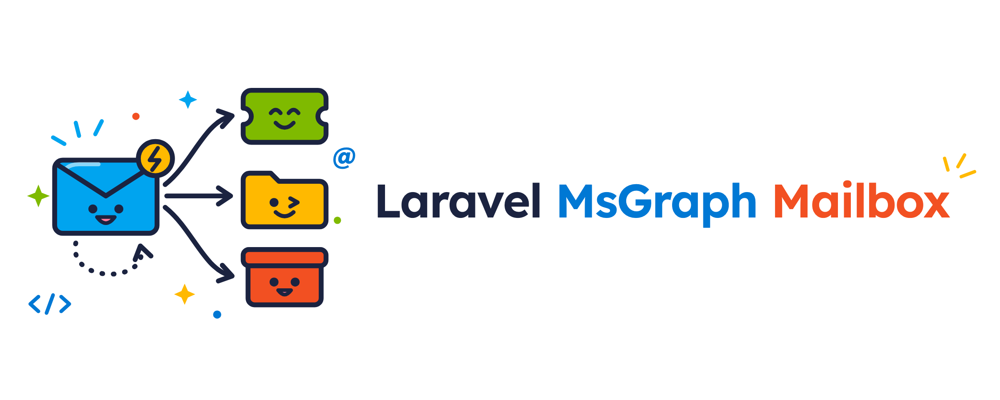

<p align="center">
    
</p>

# Laravel Microsoft Graph Mailbox

[](https://packagist.org/packages/innoge/laravel-msgraph-mailbox)
[](https://github.com/innoge/laravel-msgraph-mailbox/actions?query=workflow%3Arun-tests+branch%3Amain)
[](https://packagist.org/packages/innoge/laravel-msgraph-mailbox)

- [Introduction](#introduction)
- [Installation](#installation)
    - [Registering the Entra App](#registering-the-entra-app)
    - [Configuring Mailboxes](#configuring-mailboxes)
    - [Going Live](#going-live)
    - [Scheduling the Commands Yourself](#scheduling-the-commands-yourself)
    - [Registering the Webhook Route Yourself](#registering-the-webhook-route-yourself)
- [Receiving Messages](#receiving-messages)
- [Working With Messages](#working-with-messages)
    - [Reading Messages](#reading-messages)
    - [Attachments](#attachments)
    - [Organizing Messages](#organizing-messages)
    - [Queued Actions](#queued-actions)
- [A Complete Example](#a-complete-example)
- [Testing](#testing)
- [How It Works](#how-it-works)
- [Local Development](#local-development)
- [Security](#security)

<a name="introduction"></a>
## Introduction

Plenty of applications have a shared Microsoft 365 mailbox somewhere next to them: a support inbox, an invoices
mailbox, a "reply to this email" address. Laravel Microsoft Graph Mailbox turns those mailboxes into Laravel events.
When a message arrives, your listener receives it, and you can read it, store its attachments and archive it, all with
a few lines of familiar Laravel code:

```php
use InnoGE\LaravelMsGraphMailbox\Events\MessageReceived;

Event::listen(function (MessageReceived $event) {
    $message = $event->message();

    Ticket::createFromEmail($message->from()->address, $message->subject(), $message->body());

    $message->archive();
});
```

Some things you might build with it:

- **Support desks** that turn incoming mail into tickets and attach replies to the right ticket.
- **Document intake** that stores invoices, delivery notes or applications from a mailbox in your storage.
- **Mailbox automation** that routes, flags, categorizes or archives mail based on your own rules.
- **Bounce and out-of-office handling** that marks addresses as unreachable.
- **CRM activity logs** that record every email a customer sends you.

Under the hood, the package listens to Microsoft Graph change notifications, so messages reach your application within
seconds, and a scheduled delta sync guarantees nothing is lost when a notification is missed.

<a name="installation"></a>
## Installation

The package requires PHP 8.3+ and Laravel 12.53+ or 13. Install it with Composer, then run the install command. It
publishes the configuration file and the migration, adds the credential variables to your `.env` file and asks which
mailbox you'd like to observe:

```shell
composer require innoge/laravel-msgraph-mailbox

php artisan msgraph-mailbox:install
```

The package uses the Microsoft Graph client of [innoge/laravel-msgraph-mail](https://github.com/innoge/laravel-msgraph-mail).
You don't have to use its mail driver, but if you do, both packages share the same credentials.

<a name="registering-the-entra-app"></a>
### Registering the Entra App

The package authenticates as a Microsoft Entra app with an application permission. If you already send mail with
`innoge/laravel-msgraph-mail`, you can use the same app and simply add the permission.

1. In the [Entra admin center](https://entra.microsoft.com), go to **App registrations** and create a new
   registration. Note the **Application (client) ID** and the **Directory (tenant) ID**.
2. Under **Certificates & secrets**, create a client secret, or upload a certificate if you'd rather not rotate
   secrets.
3. Under **API permissions**, add the Microsoft Graph **application** permission `Mail.ReadWrite` and grant admin
   consent. If you only observe mailboxes and never act on messages, `Mail.Read` is enough.
4. Limit the app to the mailboxes it should see. An application permission covers every mailbox in your tenant by
   default, so restrict it with [RBAC for Applications](https://learn.microsoft.com/exchange/permissions-exo/application-rbac)
   or an Application Access Policy:

```powershell
New-ApplicationAccessPolicy -AppId <client-id> -PolicyScopeGroupId observed-mailboxes@example.com `
    -AccessRight RestrictAccess -Description "Laravel mailbox observer"
```

Then add the credentials to your `.env` file:

```ini
MICROSOFT_GRAPH_TENANT_ID=
MICROSOFT_GRAPH_CLIENT_ID=
MICROSOFT_GRAPH_CLIENT_SECRET=

# Or, when authenticating with a certificate (PEM content or a local file path):
MICROSOFT_GRAPH_CERTIFICATE=
MICROSOFT_GRAPH_PRIVATE_KEY=
MICROSOFT_GRAPH_KEY_PASSPHRASE=
```

<a name="configuring-mailboxes"></a>
### Configuring Mailboxes

Tell the package which mailboxes to observe in `config/msgraph-mailbox.php`. A plain address observes the inbox:

```php
'mailboxes' => ['support@example.com'],
```

Use the mailbox's primary SMTP address rather than an alias, since Microsoft reports senders by their primary
address. If you need more control, you may choose the folders and the events of each mailbox:

```php
use InnoGE\LaravelMsGraphMailbox\Enums\WellKnownFolder;
use InnoGE\LaravelMsGraphMailbox\Events\MessageReceived;
use InnoGE\LaravelMsGraphMailbox\Events\MessageRemoved;

'mailboxes' => [
    'support@example.com' => [
        'folders' => [WellKnownFolder::Inbox, 'Support/Escalations'],
        'events' => [MessageReceived::class, MessageRemoved::class],
    ],
],
```

Folders are `WellKnownFolder` cases or display name paths. If a folder doesn't exist, the package tells you instead of
silently observing nothing.

#### Mailboxes From Your Database

When the mailboxes live in your database, pass them to `Mailbox::observe` in the `boot` method of your
`AppServiceProvider`. Use a closure, so the database is only queried when the package needs the mailboxes. The
closure returns the same shape as the configuration:

```php
use InnoGE\LaravelMsGraphMailbox\Facades\Mailbox;

Mailbox::observe(fn () => Team::pluck('support_mailbox'));
```

<a name="going-live"></a>
### Going Live

Run the subscribe command whenever you deploy. It creates, renews and removes Microsoft Graph subscriptions to match
your configured mailboxes:

```shell
php artisan msgraph-mailbox:subscribe
```

The package schedules this command hourly, and a delta sync every fifteen minutes, so make sure your
[scheduler](https://laravel.com/docs/scheduling) and a [queue worker](https://laravel.com/docs/queues) are running.
Microsoft must be able to reach your application over HTTPS at `/webhooks/msgraph-mailbox`.

At any time, you may check on your mailboxes. The command exits with a non-zero status when something needs your
attention, so you can use it for monitoring, too:

```shell
php artisan msgraph-mailbox:status
```

<a name="scheduling-the-commands-yourself"></a>
### Scheduling the Commands Yourself

If you'd rather decide when the commands run, turn off the automatic scheduling in your `.env` file:

```ini
MSGRAPH_MAILBOX_SCHEDULE=false
```

Then schedule both commands in your application's `routes/console.php` file. Run the subscribe command at least once
a day so subscriptions are renewed before they expire, and the sync every few minutes, since it catches every change
a webhook missed and is your only source of events when webhooks are disabled:

```php
use Illuminate\Support\Facades\Schedule;

Schedule::command('msgraph-mailbox:subscribe')->hourly()->onOneServer()->withoutOverlapping();
Schedule::command('msgraph-mailbox:sync')->everyFifteenMinutes()->onOneServer();
```

If you only want different intervals, keep the automatic scheduling and change the `subscriptions.cron` and
`sync.cron` options in the `config/msgraph-mailbox.php` configuration file instead.

<a name="registering-the-webhook-route-yourself"></a>
### Registering the Webhook Route Yourself

The package registers its webhook route, `POST /webhooks/msgraph-mailbox`, outside the `web` middleware group, so
there is no session and no CSRF check. You may change the path and add middleware with the `webhooks.path` and
`webhooks.middleware` options in the `config/msgraph-mailbox.php` configuration file.

If the route should live on a specific domain or behind a prefix, turn off the automatic registration:

```php
'webhooks' => [
    'register_route' => false,
    // ...
],
```

Then register the route in one of your route files with `Mailbox::routes()`. It still uses the configured path and
middleware, and the subscribe command picks up the resulting URL automatically:

```php
use InnoGE\LaravelMsGraphMailbox\Facades\Mailbox;

Route::domain('hooks.example.com')->group(function () {
    Mailbox::routes();
});
```

Keep the route out of the `web` group, Microsoft's requests would fail the CSRF check, and don't rate limit it:
Microsoft retries rejected notifications and eventually drops subscriptions that keep failing. Disabling webhooks
entirely with `MSGRAPH_MAILBOX_WEBHOOKS=false` removes the route as well.

<a name="receiving-messages"></a>
## Receiving Messages

Every change in an observed folder becomes an event:

| Event | When it fires |
|---|---|
| `MessageReceived` | A message arrives in the folder, or is moved there. |
| `MessageMoved` | A message is moved to another folder of the mailbox. |
| `MessageDeleted` | A message is deleted and sits in Deleted Items. |
| `MessagePermanentlyDeleted` | A message is deleted permanently, or with Shift+Delete. |
| `MessageChanged` | A message is read, flagged, categorized or edited. Opt-in, see below. |

`MessageMoved`, `MessageDeleted` and `MessagePermanentlyDeleted` all implement `MessageRemoved`, so a single listener
can handle every way a message leaves a folder. To handle every event at once, listen for `MessageEvent`.

When a message is moved, you may ask where it went:

```php
public function handle(MessageMoved $event): void
{
    if ($event->movedTo(WellKnownFolder::Archive)) {
        // ...
    }
}
```

Each event carries the `mailbox`, the `folder` and the `messageId`. The message itself is loaded lazily, the first time
you call `message()`:

```php
public function handle(MessageReceived $event): void
{
    $subject = $event->message()->subject();
}
```

`MessageChanged` is disabled by default. Outlook changes a message each time someone reads, flags or categorizes it,
so enable it only for the folders that really need it.

Events are delivered at least once. On rare occasions, such as a retried sync, a listener may see the same message
twice, so keep your listeners idempotent, for example by remembering the message's `internetMessageId()`.

<a name="working-with-messages"></a>
## Working With Messages

You may work with any message of an observed mailbox through the `Mailbox` facade:

```php
use InnoGE\LaravelMsGraphMailbox\Facades\Mailbox;

$message = Mailbox::for('support@example.com')->message($id);
```

<a name="reading-messages"></a>
### Reading Messages

The first property you access loads the message with a single request:

```php
$message->subject();
$message->from();               // EmailAddress with ->address and ->name
$message->to();
$message->cc();
$message->receivedAt();         // CarbonImmutable
$message->internetMessageId();
$message->header('Auto-Submitted');
$message->isRead();
$message->flagStatus();         // FlagStatus enum
$message->categories();
```

The body is fetched separately, as text unless you ask for HTML. Pass `unique: true` to get only the new part of a
reply, without the quoted conversation:

```php
use InnoGE\LaravelMsGraphMailbox\Enums\BodyType;

$message->body();
$message->body(BodyType::Html);
$message->body(unique: true);
```

HTML bodies are returned as Microsoft delivers them, so sanitize them before you render them.

Automatic replies, bounces and your own sent mail can easily trigger loops. The package never skips a message on its
own, but it helps you decide:

```php
if ($message->isAutoSubmitted() || $message->isFromSelf()) {
    return;
}
```

You may also get the raw RFC 822 message as a stream with `$message->mime()`.

<a name="attachments"></a>
### Attachments

Listing attachments only loads their metadata. Their content is downloaded when you ask for it:

```php
foreach ($message->attachments() as $attachment) {
    Storage::put("invoices/{$attachment->safeFilename()}", $attachment->stream());
}
```

`safeFilename()` strips paths and control characters from the sender's file name, and `contents()` returns the
content as a string. Attachments larger than `attachments.max_bytes` (25 MB by default) are never downloaded.

<a name="organizing-messages"></a>
### Organizing Messages

Actions may be chained, so handling a message usually reads like a sentence:

```php
$message->markRead()->categorize('Customer')->archive();
```

Here's everything you can do with a message:

```php
use InnoGE\LaravelMsGraphMailbox\Enums\FlagStatus;
use InnoGE\LaravelMsGraphMailbox\Enums\WellKnownFolder;

$message->archive();
$message->move('Support/Done');
$message->move('Support/Done', createMissing: true);
$message->copy(WellKnownFolder::Inbox);     // Returns the copy
$message->markRead();
$message->markUnread();
$message->flag(FlagStatus::Complete);
$message->unflag();
$message->categorize('Customer', 'Urgent'); // Adds categories
$message->setCategories(['Customer']);      // Replaces all categories
$message->delete();                         // Moves the message to Deleted Items
$message->permanentDelete();
```

Message ids stay the same when a message moves, so you may safely store them.

<a name="queued-actions"></a>
### Queued Actions

Every action is also available as a queued job. Jobs are throttled per mailbox and unique for a few minutes, so
dispatching the same action twice doesn't run it twice:

```php
use InnoGE\LaravelMsGraphMailbox\Jobs\MoveMessage;

MoveMessage::dispatch('support@example.com', $id, WellKnownFolder::Archive);
```

The jobs are `MoveMessage`, `CopyMessage`, `MarkMessageRead`, `MarkMessageUnread`, `FlagMessage`, `CategorizeMessage`,
`DeleteMessage` and `PermanentlyDeleteMessage`.

Microsoft allows about four concurrent requests per mailbox. When your own queued listeners or jobs call Graph, add the
`ThrottleGraphRequests` middleware. It shares the package's limit per mailbox and releases the job when Microsoft
throttles it or is unavailable:

```php
use InnoGE\LaravelMsGraphMailbox\Jobs\Middleware\ThrottleGraphRequests;

public function middleware(MessageReceived $event): array
{
    return [new ThrottleGraphRequests($event->mailbox)];
}
```

<a name="a-complete-example"></a>
## A Complete Example

Let's attach replies to support tickets. Customers answer emails whose subject contains the ticket number, like
`[TICKET-1042]`. First, observe the support inbox:

```php
'mailboxes' => ['support@example.com'],
```

Next, write a queued listener. It skips automatic replies, attaches the reply and its attachments to the ticket and
archives the email:

```php
namespace App\Listeners;

use App\Models\Ticket;
use Illuminate\Contracts\Queue\ShouldQueue;
use Illuminate\Support\Str;
use InnoGE\LaravelMsGraphMailbox\Events\MessageReceived;
use InnoGE\LaravelMsGraphMailbox\Jobs\Middleware\ThrottleGraphRequests;

class AttachReplyToTicket implements ShouldQueue
{
    public function handle(MessageReceived $event): void
    {
        $message = $event->message();

        if ($message->isAutoSubmitted() || $message->isFromSelf()) {
            return;
        }

        $ticket = Ticket::where('number', Str::match('/\[(TICKET-\d+)\]/', (string) $message->subject()))->first();

        if (! $ticket) {
            return;
        }

        $reply = $ticket->replies()->firstOrCreate(
            ['internet_message_id' => $message->internetMessageId()],
            ['from' => $message->from()?->address, 'body' => $message->body(unique: true)],
        );

        foreach ($message->attachments() as $attachment) {
            $reply->addMediaFromStream($attachment->stream())->usingFileName($attachment->safeFilename())->toMediaCollection();
        }

        $message->archive();
    }

    public function middleware(MessageReceived $event): array
    {
        return [new ThrottleGraphRequests($event->mailbox)];
    }
}
```

`firstOrCreate` keyed by the `internetMessageId` keeps the listener idempotent. Finally, test it:

```php
use InnoGE\LaravelMsGraphMailbox\Enums\WellKnownFolder;
use InnoGE\LaravelMsGraphMailbox\Facades\Mailbox;

it('attaches replies to their ticket', function () {
    $ticket = Ticket::factory()->create(['number' => 'TICKET-1042']);
    $mailbox = Mailbox::fake();

    $message = $mailbox->receive('support@example.com', [
        'subject' => "Re: [TICKET-1042] My order hasn't arrived",
        'from' => ['emailAddress' => ['address' => 'customer@example.org']],
        'uniqueBody' => ['content' => 'It arrived today, thanks!'],
    ]);

    expect($ticket->replies()->sole()->body)->toBe('It arrived today, thanks!');
    $mailbox->assertMoved($message, WellKnownFolder::Archive);
});
```

<a name="testing"></a>
## Testing

`Mailbox::fake()` swaps Microsoft Graph for an in-memory fake. The `receive` method adds a message and dispatches
`MessageReceived` through your real listeners, so you test them exactly as they run in production. Messages use the
shape of Microsoft Graph's message JSON, with attachments as `contentBytes` and the raw MIME message under `mime`:

```php
$mailbox = Mailbox::fake();

$message = $mailbox->receive('support@example.com', [
    'subject' => 'Invoice 2026-114',
    'body' => ['content' => 'Please find the invoice attached.'],
    'attachments' => [['id' => 'a1', 'name' => 'invoice.pdf', 'contentBytes' => base64_encode($pdf)]],
]);
```

You may also seed messages without dispatching an event with `addMessage`. Afterwards, assert what your code did:

```php
$mailbox->assertMoved($message, WellKnownFolder::Archive);
$mailbox->assertCopied($message, 'Accounting');
$mailbox->assertMarkedRead($message->id);
$mailbox->assertMarkedUnread($message->id);
$mailbox->assertFlagged($message->id, FlagStatus::Complete);
$mailbox->assertCategorized($message, ['Invoice']);
$mailbox->assertDeleted($message->id);
$mailbox->assertPermanentlyDeleted($message->id);
$mailbox->assertNothingPerformed();
```

Every assertion accepts the `Message` itself or its id, and an optional `mailbox:` argument. To test code that talks to the webhook route itself,
`WebhookPayload::change($folder)` and `WebhookPayload::lifecycle($folder, LifecycleEvent::Missed)` build notifications
with a valid client state.

<a name="how-it-works"></a>
## How It Works

For every observed folder, the package keeps a Microsoft Graph subscription and a delta link. When something changes,
Microsoft notifies the webhook route, which queues a delta sync of that folder. The notification itself is never
trusted: the delta sync asks Microsoft what changed and compares it with the messages it already knows. A scheduled
sync runs every fifteen minutes as a safety net, so a missed notification delays an event but never loses it.

The first sync of a folder records the messages that are already there without firing any events. From then on,
every change becomes an event. Message ids are [immutable](https://learn.microsoft.com/graph/outlook-immutable-id), so
an id stays valid after a message moves.

<a name="local-development"></a>
## Local Development

Microsoft can't reach `localhost`, so locally you have two options. Disable the webhooks and let the delta sync deliver
your events:

```ini
MSGRAPH_MAILBOX_WEBHOOKS=false
```

Or share your site through a tunnel such as `herd share` or ngrok and point Microsoft to it:

```ini
MSGRAPH_MAILBOX_NOTIFICATION_URL=https://your-tunnel.example/webhooks/msgraph-mailbox
```

<a name="security"></a>
## Security

- `Mailbox::for()` only acts on observed mailboxes and the patterns in `allowed_mailboxes`, so an address that comes
  from user input can never reach another mailbox of your tenant. `Mailbox::forUnrestricted()` skips this check; when
  you use it, authorizing the address is up to you.
- Every subscription has its own random client state. Only its hash is stored, and notifications with an unknown
  subscription or a wrong client state are dropped without any request to Microsoft.
- The Graph client only ever sends its token to `https://graph.microsoft.com/v1.0/`.
- Events and queued jobs only carry ids. Message content never ends up in your queue or in `failed_jobs`.

If you discover a security vulnerability, please email the maintainers instead of opening an issue.

## Changelog

Please see the [CHANGELOG](CHANGELOG.md) for what has changed recently.

## Credits

- [Tim Geisendoerfer](https://github.com/geisi)
- [All Contributors](../../contributors)

## License

The MIT License (MIT). Please see the [License File](LICENSE.md) for more information.
